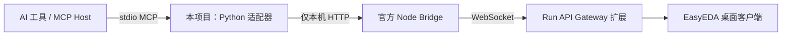

# EasyEDA Local MCP Adapter

**把 EasyEDA 官方本地 HTTP Bridge 接入支持 stdio MCP 的 AI 工具。**

这个 Python 适配器提供桥接状态、已连接窗口列表和指定窗口的 JavaScript 执行三个工具。它负责 MCP 与 HTTP 之间的协议衔接，不替代 EasyEDA、官方 API 文档或 Run API Gateway 扩展，也不是 EasyEDA 官方产品。



*上图为连接结构示意，不是软件运行截图。*

## 解决的问题

- 让标准 MCP 客户端复用官方 Bridge，而不用重新实现 EDA API。
- 操作前检查服务身份与已连接窗口，执行必须提供明确的 `window_id`。
- 不回退到当前活动窗口，不自动重复执行结果不确定的请求。
- 将 HTTP 错误、超时与可能已经发生的设计修改明确反馈给调用方。

**当前状态：本地协议适配与隔离测试可运行。** 本次公开整理只使用模拟 HTTP Bridge 验证，未启动真实 Bridge、打开 EasyEDA 或改动任何设计。

## 技术栈与前置条件

| 层次 | 依赖 |
|---|---|
| 适配器与测试 | Python 3.12；MCP Python SDK `2.1.0` |
| 真实 EDA 连接 | EasyEDA 专业版桌面客户端、官方 `easyeda-api-skill`、Run API Gateway 扩展 |
| 可选启动官方 Bridge | Node.js 18+，以及已经安装依赖的官方 Skill 目录 |

Python 网络与测试部分使用标准库。SDK 版本固定在 `requirements.txt`；MCP v1 的低层回调接口不同，不能直接替换。Python 3.12 / Windows 已测试，其他系统尚未实测。

第三方前置请从官方入口获取：

- [EasyEDA API Skill 与 Bridge](https://github.com/easyeda/easyeda-api-skill)
- [Run API Gateway 官方扩展](https://github.com/easyeda/eext-run-api-gateway)
- [MCP Python SDK](https://github.com/modelcontextprotocol/python-sdk)

本仓库不包含或重新打包这些第三方软件。

## 最简运行：先做离线隔离测试

这一步不需要 EasyEDA、Node.js 或真实 Bridge。

```powershell
python -m venv .venv
.venv\Scripts\python -m pip install -r requirements.txt
.venv\Scripts\python test_adapter.py
```

macOS / Linux 使用 `.venv/bin/python` 替代上面的 `.venv\Scripts\python`。测试启动临时回环 HTTP 服务，并把 MCP 测试子进程限制到该模拟端口；不会扫描或连接正式 EDA Bridge，也不会执行真实设计代码。

## 接入 MCP 客户端

将本项目的解释器和 `server.py` 绝对路径配置到客户端。以支持 TOML 配置的 MCP Host 为例：

```toml
[mcp_servers.easyeda]
command = "/absolute/path/to/easyeda-local-mcp-adapter/.venv/bin/python"
args = ["/absolute/path/to/easyeda-local-mcp-adapter/server.py"]
startup_timeout_sec = 20
tool_timeout_sec = 60
```

Windows 将解释器路径改为 `.venv/Scripts/python.exe`，路径可使用正斜杠。示例只是配置模板，不是可直接复制的本机私人配置。保留客户端的其他设置；客户端应按其支持的刷新方式加载服务。

`server.py` 是 stdio 协议进程，没有网页界面。直接在终端运行会等待 MCP 请求，不会显示产品页面；不要向其标准输出添加调试文本。

## 官方 Bridge 的准备

先按官方 Skill 的当前说明安装依赖、加载 Run API Gateway，并阅读 `SKILL.md` 及要调用的 API 准确签名、参数、枚举、单位与备注。本适配器默认不启动 Bridge。

可配置以下可选环境变量，**无需建立或上传 `.env` 文件**：

| 变量 | 作用 | 默认 |
|---|---|---|
| `EASYEDA_SKILL_DIR` | 官方 Skill 目录 | 当前用户主目录下的 `.codex/skills/easyeda-api` |
| `EASYEDA_NODE` | Node 可执行文件路径 | 在系统 PATH 中查找 `node` |

只有明确调用 `easyeda_status` 并传入 `start_bridge: true`，才会尝试启动已存在的官方脚本；不会安装包、加载扩展、启动 EasyEDA 或关闭现有 Bridge。Windows 后台启动不显示窗口，日志保存在本项目 `bridge.log`，已排除在 Git 中。

## 三个工具

| 工具 | 输入 | 行为 |
|---|---|---|
| `easyeda_status` | 可选 `start_bridge`，默认 `false` | 扫描回环端口 49620—49629，校验 `service: easyeda-bridge`；可选启动已安装的官方 Bridge |
| `easyeda_windows` | 无 | 读取已连接窗口列表 |
| `easyeda_execute` | 非空 `code` 与 `window_id` | 确认目标窗口仍连接，向该窗口发送一次 JavaScript 执行请求 |

调用顺序：

1. 查看状态，再列出窗口。
2. 确认目标窗口、当前工程与文档类型；多窗口不明确时先解决目标选择。
3. 按官方文档确认每个 API 的签名与单位，在 JavaScript 中 `await` Promise 并 `return` 结果。
4. 执行后读回验证。超时或传输失败可能表示代码已经运行，先检查设计状态，不能盲目重试。

适配器禁用代理与 HTTP 重定向，固定访问 `127.0.0.1`；多个 Bridge 实例同时被发现时会报错。它不自动切换活动窗口，也不自动重试执行请求。

## 目录结构

```text
server.py                         Bridge HTTP 客户端与 stdio MCP 服务
test_adapter.py                   隔离单元测试及 MCP 协议测试
test_support/stdio_fake_bridge.py  测试子进程，仅连接指定模拟端口
requirements.txt                  固定的 SDK 依赖
docs/validation.md                本次验证范围与限制
LICENSE                           原创适配器的 MIT 许可
```

## 开发与验证

```powershell
python -m unittest -v test_adapter
```

检查涵盖服务身份、未连接状态、明确窗口路由、错误/超时不重试、多 Bridge 拒绝、禁止重定向、非法输入，以及真实 MCP stdio 初始化、列工具与调用状态。所谓“真实 MCP”指实际 SDK 客户端和适配器进程；EDA 一侧全部为模拟服务。具体结果见 [验证记录](docs/validation.md)。

GitHub Pages 无法提供本机 stdio 或访问你电脑上的 EDA，故本项目以源码、接入说明与结构图展示，不提供伪装的在线 EDA 操作演示。

## 更新与后续计划

- **V1：** 三工具 stdio 适配、服务身份验证、明确窗口路由、错误与执行不确定性反馈。
- **2026-10-26 开源整理：** 去除私人解释器与项目路径，补齐依赖；Node / Skill 路径改为可配置；协议测试全部隔离到模拟 Bridge。
- **后续：** 在明确授权的独立示例工程中补充新版官方 Bridge 兼容性实测，不把协议测试当作设计正确性、DRC 或实板验证。

## 许可与来源

原创适配器、测试与本文档采用 [MIT License](LICENSE)。EasyEDA、官方 Skill / Bridge、Run API Gateway 和 MCP SDK 保留各自权利与许可。本项目只调用其公开接口，没有复制官方 Bridge、扩展包或 API 文档，也不包含私人配置、Bridge 日志或原始 EDA 设计。
